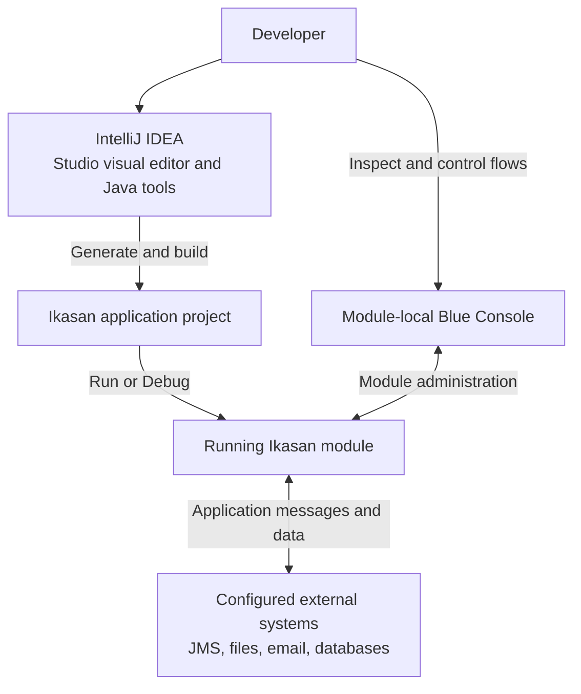

# Your first module in five minutes

This walkthrough creates a scheduled flow that writes to the application log. Allow extra time for the first Maven downloads and IntelliJ indexing; the five minutes starts with the plugin, project JDK and dependencies ready.

## Where Studio fits

Studio helps build the application inside IntelliJ; the running module connects to your integration endpoints. Console opens that module's Blue Console.

The first example below uses only a timer and logging; it does not need those external systems.

## Before you start

Follow the [installation guide](Installation.md), then use [Supported versions](SupportedVersions.md) to choose an IDE and project JDK. Marketplace availability and candidate ZIP installation are described separately there.

## 1. Create the project

Choose **File → New → Project → Java**, with **Maven** as the build system. A standard Maven quickstart project also works. Give it a name and select the JDK for your intended Ikasan version. No Ikasan archetype needs to be installed or downloaded.

Wait for Maven import, then click the squid icon on the far-right stripe or use **Tools → Ikasan Studio → Set up Ikasan Studio Project…**. In the Studio editor, choose **Set up project** if prompted.

## 2. Configure the module

Select the Ikasan version, application Java package, HTTP port and matching installed JDK: Java 11 for V3.3.9, Java 17 for V4.1.6 or Java 25 for V5.1.0. Review the file list and compare changes before applying setup. Studio creates the Maven reactor, boot application, model and deployment files, then reloads Maven and opens the designer. Normal dependency downloads still require access to your Maven repositories.

Setup supports a simple, single-module Maven JAR project. Existing source files, resources and tests move unchanged into `jar/user/src/`; dependencies move into `jar/user/pom.xml`. Existing instruction files are preserved. Custom profiles, active build plugins, conflicting directories and existing runtime application configuration require separate review rather than automatic conversion. Use a fresh project and the [runtime import workflow](SourceAssistedModuleImport.md) for an existing integration application.

Setup saves original changed files and its plan in `.ikasan-studio/setup/<id>/`. It rejects changes made since review and rolls back its writes if setup fails. Keep that backup until you have checked the resulting project.

Existing Studio archetype projects remain supported and open normally; archetype use is optional. In the designer, review module properties, enable **useEmbeddedH2** for this example, and leave **flowStartupType** as **AUTOMATIC**. Apply edits with **Update Code**.

Before configuring external test services, review **LOCAL_TEST_ENVIRONMENT.md** in the workspace root. It is developer-owned guidance, not automatically loaded runtime configuration. Add `/LOCAL_TEST_ENVIRONMENT.md` to `.gitignore` when it contains local values.

## 3. Build the flow

Drag a **Flow** from the palette onto the canvas and name it `HelloFlow`. Add a **Scheduled Consumer**, followed by a **Logging Producer**. Give each a distinct name. On the consumer, set **cronExpression** to `*/5 * * * * ?` (every five seconds), leave **messageProvider** unset to use the built-in Quartz provider, and leave **eager** false. Apply each property form with **Update Code** and complete any mandatory fields highlighted by the selected pack.

This example needs no JMS broker, FTP server or email account. The built-in provider emits a Quartz job context (a timer event), which the Logging Producer accepts; no converter or custom Java is needed.

## 4. Run and inspect

Click **Run module**. Studio selects or creates an IntelliJ Application run configuration. Wait for the application startup message in the Run console, then look for the flow's logging output. A launched process alone does not mean startup has finished.

To show or hide **H2**, **Console** and **Reload from Disk**, right-click the Studio toolbar and toggle **Show advanced controls**. This uses the same saved preference as **Settings → Tools → Ikasan Studio**.

Open **Console** to view the module-local **Blue Console**. The local example login is `admin` / `admin`. Check that `HelloFlow` is running. The Blue Console is distinct from the central Ikasan Dashboard.

To inspect source, use a component's **Jump to Code** or **Jump to Properties** action when offered. Pending property changes do not need to be accepted merely to inspect an available navigation target.

## 5. Debug and stop

Stop the Run session, add a **Debug** component between the consumer and producer, apply **Update Code**, and use **Jump to Code** to set a breakpoint in its `debug()` method, and start **Debug module** or debug the selected Application configuration using IntelliJ's controls. Resume execution after inspecting the event. Stop the application through the Run/Debug window when finished.

You now have a saved visual model and generated application. Keep `jar/generated/src/main/model/model.json` in version control (`generated/src/main/model/model.json` in legacy projects). See [Application project layout](ProjectLayout.md) for the familiar `jar/`, `bin/` and `distribution/` structure. Read [Project files and recovery](ProjectFilesAndRecovery.md) before editing generated Java, and [Harnesses](Harnesses.md) when adding external endpoints.

## More room for the canvas

Use **Hide panels** at the top-right of the designer to hide Properties and Palette.
The same button becomes **Show panels**, restoring their previous width and selected tab.
Pending property edits are preserved; hiding the panels does not apply them.

### Importing an existing model

For module metadata and separate configuration JSON downloaded from core Ikasan or the Dashboard, select runtime import in the same dialog. See [Importing Ikasan runtime JSON](IkasanRuntimeJson.md) for component choices and settings that need review. **Tools → Ikasan Studio → Import Module…** also guides [bespoke source and local configuration import](SourceAssistedModuleImport.md) from the original checkout.

Importing `model.json` from **Create your Ikasan module** regenerates Studio-owned files
and aligns the root Maven POM with the imported meta-pack: Java 11 for V3.3.9 or Java 17
for V4.1.6, the Ikasan BOM and required component dependencies. Unrelated Maven settings
are retained. Existing compiler source/target settings (including legacy Java 7 values)
and an existing `maven.compiler.release` property are updated even when no dependency
changes are needed. Configure a matching installed JDK if Studio cannot select one.

For a separate local development database, see [independent H2](IndependentH2.md).

### Module port defaults

New modules default the H2 database port to the application HTTP port + 1 and the H2 web
console port to HTTP + 2. During initial configuration, untouched H2 defaults follow
HTTP-port edits. Explicit H2 values are preserved. Later HTTP-port edits do not change
saved H2 ports; use **Default** beside an H2 port to calculate it again. Port fields
validate the range 1–65535 and reject duplicate local service ports. Derived defaults do
not reserve ports; check other running projects/services when starting the application.
