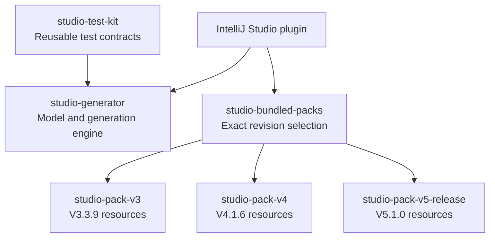

# Independent pack artifacts and releases

For a teammate starting a separate custom-pack project, begin with the [custom-pack handover](CustomMetaPackHandover.md).

## One repository, one CI project

The IntelliJ plugin, generator, test kit and official packs remain in this repository. The existing Gradle wrapper and CI pipeline build them together; no additional Travis projects or repositories are required. Publication remains explicit, with no remote repository or credentials configured by this change.

| Gradle project | Maven artifact (group `org.ikasan.studio`) | Resource ID | Target Ikasan | Initial pack revision |
| --- | --- | --- | --- | --- |
| `studio-pack-v3` | `studio-pack-v3` | `V3.3.9` | `3.3.9` | `0.1.0-SNAPSHOT` |
| `studio-pack-v4` | `studio-pack-v4` | `V4.1.6` | `4.1.6` | `0.1.0-SNAPSHOT` |
| `studio-pack-v5-release` | `studio-pack-v5-release` | `V5.1.0` | `5.1.0` | `1.0.0` |

`studio-pack-v5-release:1.0.0` is the normally bundled released adapter for `V5.1.0`.
`studio-pack-v5` remains a separate, opt-in development artifact targeting `V5.0.1-SNAPSHOT`.
The standalone Maven [Ikasan 5 authoring example](../ikasan-studio-ancillary/ikasan5-metapack/README.md)
targets runtime 5.1.0 with the distinct ID `ExampleIkasan5`.
The released resources and verification instructions are under [headless/studio-pack-v5-release](../headless/studio-pack-v5-release/README.md). The historical snapshot remains opt-in and retains its separate ID and evidence.

Each pack JAR contains only that pack's descriptors, templates and images. It has no production dependency on the generator, test kit, IntelliJ or another pack. `studio-bundled-packs` is a dependency bundle: its published POM/Gradle metadata selects all three exact revisions. The plugin consumes this bundle, and its ZIP includes all three released pack JARs. Never copy the pack resources back into the bundle or plugin JAR.

### Component dependencies

Arrows mean “depends on”. The bundle selects pack revisions; pack JARs contain resources and do not depend on the generator or IntelliJ.



Tests supply their chosen pack resources separately. The plugin archive includes the selected pack JARs.

## Version contract

The pack's `src/main/resources/studio/metapack/<id>/metapack.json` is the source of truth for `packVersion`; the corresponding Gradle project reads it to set its publication version.

| Field | Meaning |
| --- | --- |
| `id` | Existing resource/model identity, preserved for saved-project compatibility |
| `packVersion` | Independent artifact revision, such as `0.1.0-SNAPSHOT` or `1.0.1` |
| `ikasanVersion` | Target runtime release and corresponding Ikasan BOM version |
| `schemaVersion` | Manifest format; new official manifests use version 2 |
| `generatorApiVersion` | Required pack-facing generator contract; currently exactly 1 |
| `javaVersion` | Java requirement of the generated application |

Pack revisions use `major.minor.patch` with an optional qualifier. Snapshot pack builds are permitted, but dynamic selectors such as `latest`, `1.+` and version ranges are rejected. Released revisions must be immutable; replace `-SNAPSHOT` before publishing a release. Changing a template or descriptor can advance one pack revision without changing the Ikasan version, other pack revision, generator artifact version or plugin version. Increment the generator API contract only for an incompatible change to the pack-facing model/template contract; it is separate from the generator's Maven artifact version.

The loader accepts legacy schema-1 manifests without inventing revision metadata. Schema 2 requires both new fields, and incompatible generator API requirements fail validation before a pack becomes usable. An old generator that supports only schema 1 cannot consume the new schema-2 packs.

Document-format `model.json` now also records `studio.metaPackRevision` on save. A revision mismatch blocks loading and persistence until the exact revision is restored or the developer explicitly adopts the installed revision. Older unlocked models acquire a lock on their next save. The plugin distribution selects the bundled revisions. Use only one revision of each pack artifact on a classpath. Complete custom packs with unique IDs can also be installed through **Tools → Ikasan Studio → Install Meta-Pack…** and activated after an IDE restart. The install action rejects bundled or installed ID conflicts. Use **Manage Meta-Packs…** for reviewed external updates, removal, cancellation and restoration; changes activate after restart with previous JARs retained. See the [handover](CustomMetaPackHandover.md#install-into-studio).

## Build, verify and inspect without publishing

From the repository root:

```sh
# Every headless suite, including both isolated pack contracts and combined regressions
./gradlew -p headless build

# One pack's contract in isolation
./gradlew -p headless :studio-pack-v3:test
./gradlew -p headless :studio-pack-v4:test

# Inspect publication metadata; this does not publish anything
./gradlew -p headless generatePomFileForLibraryPublication

# Complete plugin tests and distribution
./gradlew test
./gradlew buildPlugin
```

JARs are in `headless/<project>/build/libs/`. POMs are in `headless/<project>/build/publications/library/pom-default.xml`. The bundle POM records both selected pack versions; individual pack POMs have no production dependencies. Test reports are in each module's `build/reports/tests/test/` directory.

## Releasing one pack

1. Update that pack's content and `packVersion` in its manifest. Leave the other pack's revision unchanged unless its content also changes.
2. Run the complete headless build, including golden-output and packaged-JAR checks. Before calling a pack certified, also compile/run representative generated applications against its exact Ikasan BOM; the current test kit checks validation and rendering.
3. Inspect the pack and bundle publication metadata. For a release of the bundle, advance the bundle artifact version when its selected pack revisions change. Its initial default is configured in `headless/build.gradle.kts`; it can be overridden in its own build file.
4. Publish the selected pack using the repository's eventual release credentials and repository configuration. A pack-only publication does not require a plugin release.
5. To deliver that revision to current plugin users, build/test/release a plugin containing the updated bundle selection. Custom complete packs with distinct IDs can be distributed separately and installed through the new install action; it cannot replace bundled IDs.

For local consumer testing only (explicitly writes to the local Maven repository):

```sh
./gradlew -p headless :studio-pack-v3:publishToMavenLocal
# Or install all artifacts needed by a standalone consumer:
./gradlew -p headless publishToMavenLocal
```

No remote publication task is configured. When one is configured, the existing single CI project can invoke publication tasks for selected modules; separate CI projects remain optional.

## Deferred extension ecosystem

Complete resource-only external pack installation is implemented with validation and activation after restart. Managed external updates/removal/rollback and saved-project revision guards are implemented. Component-extension composition, template overlays, dependency resolution, simultaneous revisions of the same ID and automatic project artifact provisioning remain future work. Start extensions with additive component identities and explicit base-pack compatibility; do not silently replace existing components. These features are not prerequisites for the first plugin release.
