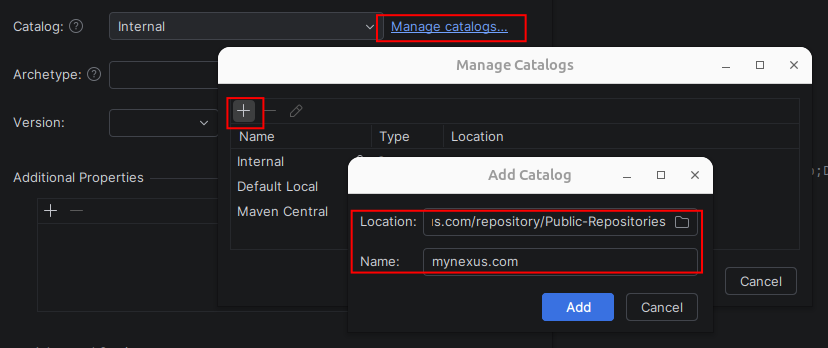

# Troubleshooting

Start with the Studio notification and the first relevant error in the Maven or Run/Debug output. a a  Later failures are often consequences of that first error. Preserve model files before attempting recovery.


| Symptom                                                | What to check                                                                                                                                                                                                                                                                                                                                                                                                                                                                                                                                                                    |
| ------------------------------------------------------ | -------------------------------------------------------------------------------------------------------------------------------------------------------------------------------------------------------------------------------------------------------------------------------------------------------------------------------------------------------------------------------------------------------------------------------------------------------------------------------------------------------------------------------------------------------------------------------- |
| Archetype absent                                       | This is common if you are in a corporate environment. First check to see if you can download the archetype manually using the**command below**. If you are going through a corporate repository like Nexus, while you are on the 'New Project screen', next to the catalogue field, click 'Manage catalogs', on tne nest screen click the plus icon, add in 'URL_to_my_nexus/repository/Public-Repositories' e.g. https://mynexus.com/repository/Public-Repositories (**see screen shot below for example**). Save and use that catalog and look for the ikasan-studio archetype |
| Maven dependencies unresolved                          | Check Maven repository access, offline mode, proxy, mirrors and credentials in your Maven settings. Refresh Maven after correcting them. The README includes a manual archetype alternative; use published coordinates appropriate to your candidate.                                                                                                                                                                                                                                                                                                                            |
| Studio waits for Maven/indexing                        | Allow initial import/indexing to finish. Inspect Maven import errors and the selected project SDK. Reopen via**Tools → Ikasan Studio → Open Ikasan Studio** if the editor was deliberately closed. Repeated cache invalidation is not the first recovery step.                                                                                                                                                                                                                                                                                                                 |
| Java release or class-version error                    | Align project SDK, Maven importer/runner and Run/Debug JRE with[Supported versions](SupportedVersions.md). IntelliJ's own runtime is separate.                                                                                                                                                                                                                                                                                                                                                                                                                                   |
| Address already in use                                 | Read the failing address in application/harness output. Check module HTTP, H2, JMS, SMTP, FTP and mail inbox ports. Stop the process that owns the port, or select another port and update both ends. Do not stop unrelated processes blindly.                                                                                                                                                                                                                                                                                                                                   |
| Mail inbox fails to open                               | Check the**Test Mail Server** Terminal and GitHub download access. The inbox uses shared local port 8025, even when SMTP ports differ. Another project can own it.                                                                                                                                                                                                                                                                                                                                                                                                               |
| FTP harness fails or SFTP cannot connect               | Check the details address, credentials and local port. The bundled server speaks plain FTP; use a separate SFTP server for SFTP transport.                                                                                                                                                                                                                                                                                                                                                                                                                                       |
| Process starts but Console/test actions fail           | Wait for the application startup message and check HTTP port/context path. A process can be alive while dependency initialization fails. Inspect the first exception in Run/Debug output.                                                                                                                                                                                                                                                                                                                                                                                        |
| Module starts but flow remains stopped                 | Inspect**flowStartupType** and Blue Console flow state/error details. Existing modules retain their configured startup type. Confirm required JMS/database/remote services are available.                                                                                                                                                                                                                                                                                                                                                                                        |
| Breakpoint never hits or Send Test Message unavailable | Use**Debug module**, wait for startup and ensure the consumer supports injection. Check that your breakpoint is in the code actually executed. Regenerate and restart after configuration or harness changes.                                                                                                                                                                                                                                                                                                                                                                    |
| Scan accepted but no file arrives                      | Check filename pattern, source directory, minimum file age and duplicate detection.**Check for files** is asynchronous. A synthetic **Send Test Message** does not verify scanning.                                                                                                                                                                                                                                                                                                                                                                                              |
| Generation fails after a converter choice              | Review source/target types and the saved recipe. Choose a compatible recipe or a custom implementation. An unknown/incompatible saved recipe blocks generation.                                                                                                                                                                                                                                                                                                                                                                                                                  |
| Model will not load or save                            | Follow[Project files and recovery](ProjectFilesAndRecovery.md). Preserve the original, inspect validated backups, permissions and disk space.                                                                                                                                                                                                                                                                                                                                                                                                                                    |

To check if you can download the archetype manually:

```shell
mvn dependency:get -U "-Dartifact=org.ikasan.studio:ikasan-studio-project-archetype:1.0.2"
```

Screen shot for changing catalog as described above



For custom component failures, inspect developer-owned implementations under `user/`; generated stubs still need business logic. After changing Maven dependencies or generated code, allow import/build to finish and restart the running module.

If the problem remains, use **Tools → Ikasan Studio → Collect Ikasan Studio Diagnostics…**. Review the local ZIP and include the Studio version, IntelliJ IDEA version/edition and full build, operating system, selected Ikasan version, reproduction steps and expected/actual behaviour in your support report. Model or application-log attachments require separate review; they are not automatically included. See [diagnostics and privacy](DiagnosticsAndPrivacy.md).


### Plugin development: IntelliJ SDK imports unresolved

If Studio sources cannot resolve `com.intellij.openapi.project.Project` or other platform
classes, check the Gradle sync output before editing imports or adding SDK JARs manually.
Use the repository's Gradle wrapper in IntelliJ's Gradle settings, then reload all Gradle projects.

The wrapper is pinned to Gradle 9.7.1. With the current IntelliJ Platform Gradle plugin 2.19.0,
local verification on 28 September 2026 reproduced bundled SDK dependency resolution failures
under Gradle 9.8.0 (`file:/maven-model`, `file:/jps-builders` and similar invalid paths), while
9.7.1 compiled both the main plugin and native MCP module successfully. Refreshing dependencies
and starting a fresh Gradle process did not resolve the 9.8.0 failure. Recheck this combination
before upgrading the wrapper. After changing versions, reload Gradle and allow indexing to finish.

The same failure was reproduced on 2 October after an automated wrapper update, including
`file:/intellij.libraries.ktor.client`, even with configuration caching disabled. The SDK JARs
were present; deleting SDK caches was unnecessary. Dependabot now ignores the specific wrapper
version 9.8.0 to prevent recurrence; later versions remain eligible for compatibility review.


## Module process starts but flow controls are missing

Studio shows flow controls only after it can read real flow states from the module's REST
API. A running JVM or an attached debugger does not establish that Spring Boot completed
startup. Leftover JMS listener threads can keep a JVM alive after startup has failed.

Studio observes module process output for Spring Boot startup-failure reports. A reported
HTTP port conflict produces an error notification and a persistent banner naming the port.
**Show Run/Debug output** opens the launch output. Stop the conflicting module, or change
the current module's HTTP port in Studio, update code and restart it. Changing a port in
properties does not move a server that is already running.

If Ikasan begins module cleanup before Spring reports startup completion, Studio reports
that premature shutdown even when the JVM remains alive and no exception is printed.
The banner states that no cause was reported; it does not infer a port conflict. Inspect
earlier output, or enable Spring Boot debug logging for a diagnostic relaunch. An explicit
operator stop and ordinary shutdown after completed startup do not trigger this warning.

The diagnostic also covers coloured console output, fatal failures reported after Spring
prints “Started Application”, and unsuccessful startup exits.
It resets on the next launch. It does not terminate either application or infer a port
conflict from a temporary 404, a slow startup or an unrelated connector error. Output is
examined in a bounded in-memory window; raw application output and credentials are not
copied into notifications or plugin logs. Launches started before this observer was attached
must be relaunched for output-based detection.
